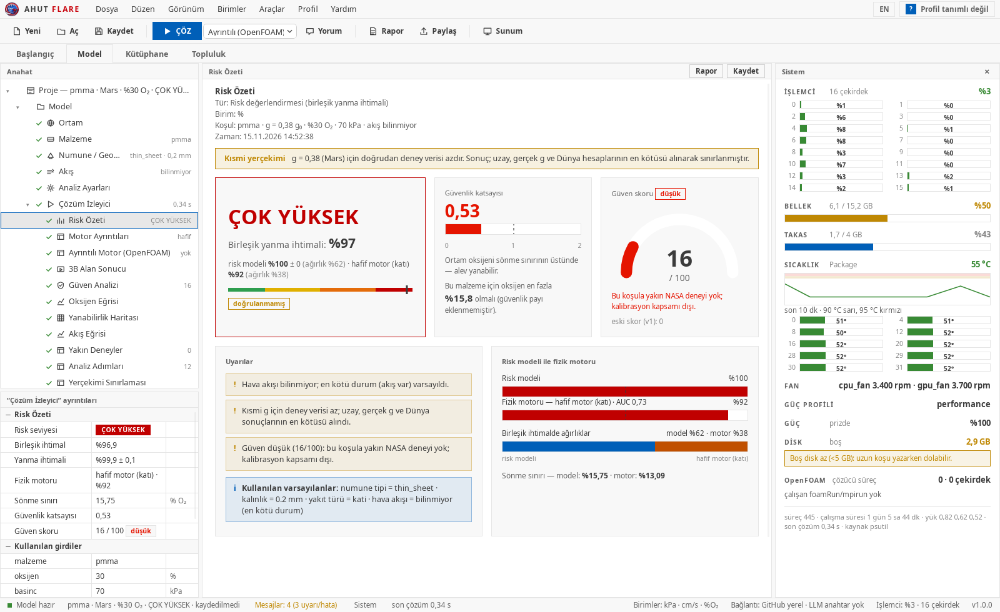
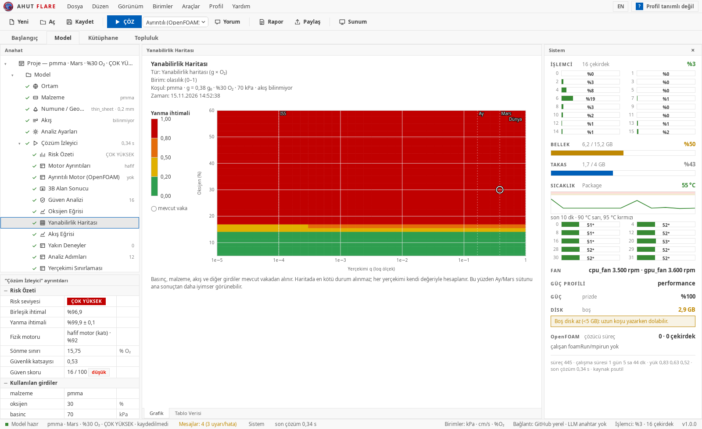
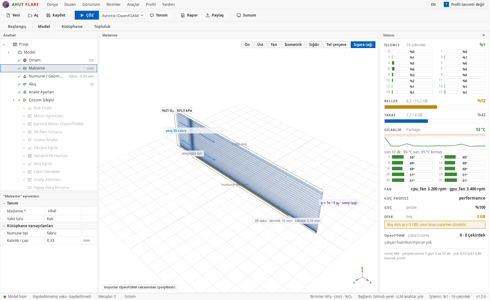
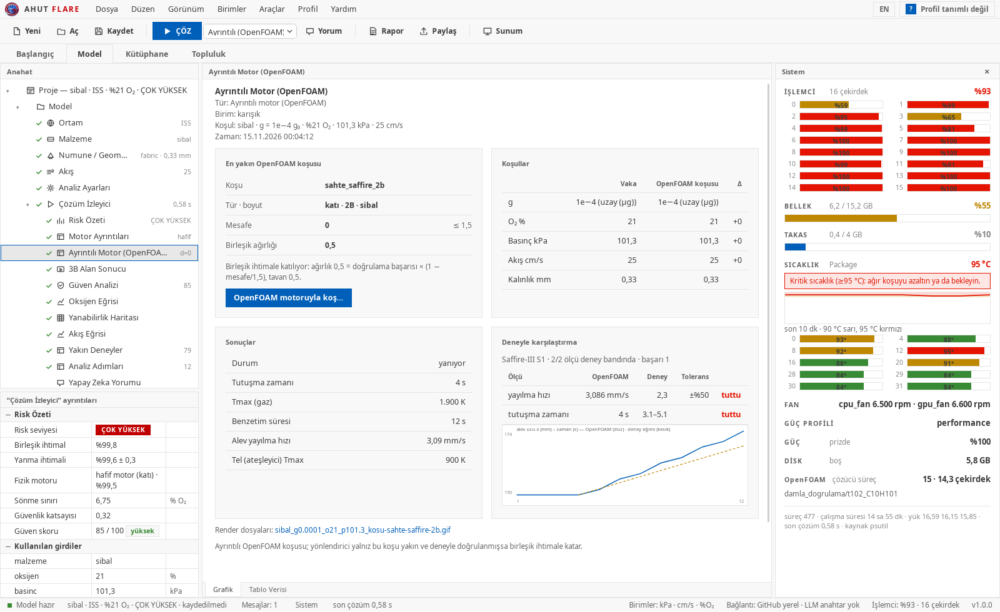
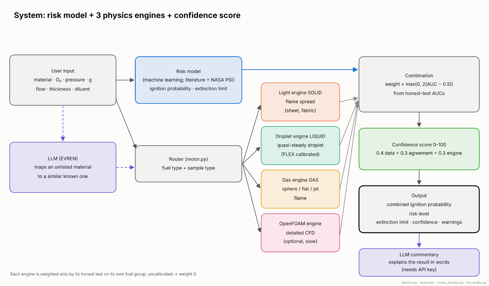
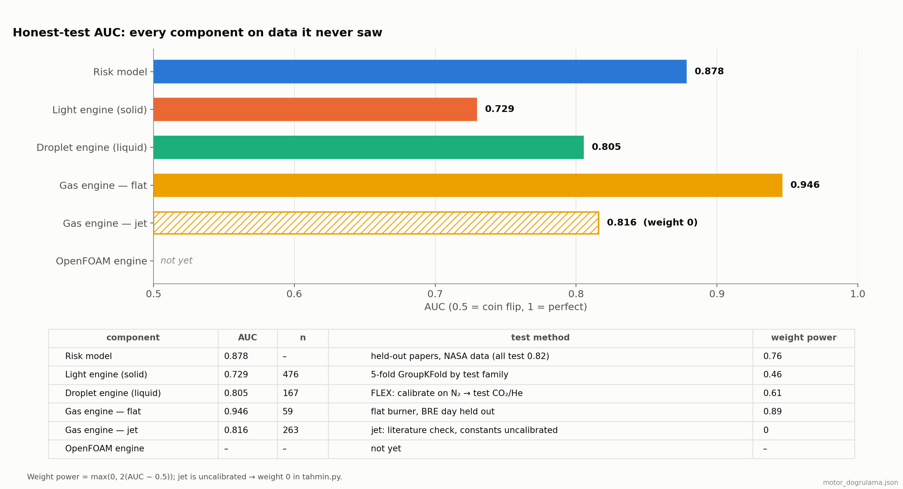

<div align="center">


# AHUT FLARE

**F**ire · **L**earning · **A**nalysis · **R**esearch · **E**ngine

*A desktop analysis environment for fire safety in space*

Predicts whether a material will burn under **ISS · Moon · Mars** conditions and compares<br>
the prediction with real **NASA microgravity combustion experiments**.


[What it does](#-what-it-does) · [Screens](#-screens) · [How it works](#-how-it-works) · [Validation](#-validation) · [Install](#-install) · [Layout](#-repository-layout) · [Data](#-data-sources)


<sub>n-heptane at Mars gravity (0.38 g): the OpenFOAM field result inside the app, with temperature iso-surfaces, a cut plane and a time slider.</sub>

</div>

---

## ✨ What it does

You give it an **environment** (gravity, pressure, oxygen, diluent gas, airflow) and a **material**. AHUT FLARE returns:

| Output | Meaning |
|---|---|
| 🔥 **Risk level** | LOW · MEDIUM · HIGH · VERY HIGH |
| 📈 **Burn probability** | 0–1, with an uncertainty range |
| 🧯 **Extinction limit** | Below this oxygen percentage the flame goes out |
| 🛡️ **Safety factor** | `extinction limit / ambient oxygen`; below 1 means "can burn" |
| ✅ **Confidence score** | 0–100; how far the result can be trusted (data proximity + model–engine agreement + engine success) |
| ⚠️ **Warnings** | Missing inputs, model–engine conflicts, out-of-calibration region |

It also provides:

- **Plots:** oxygen curve, gravity × oxygen flammability map, flow curve, and the **nearest real NASA experiments** to the chosen condition.
- **Two solution types:**
  - **Fast:** risk model plus semi-empirical engines, under a second.
  - **Detailed:** an OpenFOAM CFD run, queued from inside the app and monitored live.
- **3D viewer:** on input nodes, the sample geometry, cabin, gravity and flow arrows. On the result node, OpenFOAM fields with iso-surfaces, cut planes, time control and "open in ParaView".
- **Run monitor:** live log, residual plots, CPU / temperature / disk panel and the run queue.
- **Parameter sweep:** varies one input over a range to find the **safety threshold**. Example question: "How far can I raise oxygen for this material?"
- **AI commentary and chat (optional):** code produces every number; the language model only writes the rationale and answers "what if oxygen were 25%?" by re-running the model.
- **Two languages and two themes:** Turkish / English, light / dark.

---

## 🖼️ Screens

<table>
<tr>
<td width="50%"><br><sub><b>Risk summary</b> — PMMA in a Mars base</sub></td>
<td width="50%"><br><sub><b>Flammability map</b> — gravity × oxygen</sub></td>
</tr>
<tr>
<td><br><sub><b>3D input scene</b> — thin PMMA plate on the ISS, flow channel and igniter</sub></td>
<td><br><sub><b>OpenFOAM case</b> — Saffire SIBAL sample, real dimensions and cell mesh</sub></td>
</tr>
<tr>
<td><br><sub><b>Detailed engine</b> — OpenFOAM run ↔ fast engine ↔ experiment</sub></td>
<td><br><sub><b>Chat</b> — "what if" questions re-run the model</sub></td>
</tr>
</table>

---

## 🧠 How it works



1. **Risk model (machine learning)**
   - Trained on labelled experiments compiled from the NASA PSI experiment database and the literature.
   - Gives the burn probability and the extinction limit (`scripts/risk_model.py`, model file `dashboard/engine/models/risk.joblib`).
2. **Router** (`scripts/engine.py`) picks a physics engine by fuel type and sample type:
   - **Solid:** light flame-spread engine (`scripts/light_engine.py`)
   - **Liquid:** quasi-steady droplet engine calibrated to FLEX (`scripts/droplet_engine.py`)
   - **Gas:** sphere / flat / jet flame engine (`scripts/gas_engine.py`)
3. **Combination**
   - Model and engine are weighted by their **honest test AUCs**: `weight = max(0, 2·(AUC − 0.5))`.
   - A component that is not calibrated gets weight 0.
4. **Confidence score:** `100 × (0.4·data + 0.3·agreement + 0.3·engine)`.
5. **Detailed solution (OpenFOAM)**
   - A multi-region (gas / solid / igniter wire) pyrolysis and flame solver for solid samples: `openfoam_motor/`. Its four parts are `kinetic`, `radiation`, `pyrolysis` and `damla_buharlasma` (droplet evaporation), all under `openfoam_motor/motor/`.
   - Cases built from the panel with a library material (`dashboard/engine/ofm_case.py`):
     - Solid: SIBAL (validated) and PMMA; parameters in `ofm_material_params.json` (sourced, unvalidated ones are flagged).
     - Liquid (droplet): n-heptane, methanol, ethanol, n-decane; 1D spherical, shrinking diameter, one-step combustion (`ofm_droplet_case.py`). Only n-heptane and methanol are calibrated to FLEX.
     - Gas: methane, ethane, propane, ethylene, acetylene; porous-sphere burner, 1D spherical, microgravity (`ofm_gas_case.py`). Kinetics and transport constants are not validated and there is no radiation model.
   - Other droplet and gas burner cases: `of_*.py`.
   - Results are imported and compared with the experiment. A run enters the combined result only if it is close to the condition and validated against an experiment.
6. **LLM**
   - Maps a material that is not in the list to the nearest known material.
   - Optionally writes the commentary. The verdict line is always produced by code.

Equations and assumptions: [`presentation/equations.md`](presentation/equations.md) · Detailed technical document: [`docs/DASHBOARD.md`](docs/DASHBOARD.md)

---

## 📊 Validation

Every component was tested on **experiment families it did not see in training**, using family-grouped cross-validation.



| Component | Data | Honest test AUC |
|---|---|---|
| Risk model | NASA PSI + literature | **0.878** |
| OpenFOAM model | FLEX + SAFFIRE + BRE + BASS| **1** |


**OpenFOAM validation (in progress)**

| Experiment | Fuel type | Status |
|---|---|---|
| NASA FLEX | n-heptane droplet | Single-droplet cases are running |
| ISS BRE | ethylene burner | Axisymmetric cases are running |
| BASS | SIBAL fabric | Running |

**Known limits** (details: `presentation/presentation_summary.md`):

- **Partial gravity:** there is no direct experiment data for the Moon and Mars; results are interpolated from ISS and Earth data.
- **Radiation:** the droplet CFD cases have no radiation, so they miss the radiative extinction seen for large droplets.
- **Gas radiation:** in the gas CFD, grey-gas radiation was scaled to the measured radiant fraction.

---

## 🚀 Install

### Windows

`AHUT-FLARE-Setup.exe` → Next → Install.

Python, the model and the data are bundled in the program. The installer is built with `dashboard/packaging/`.

### Linux (Ubuntu 24.04, Python 3.12)

```bash
git clone https://github.com/ErdemA33/AHUT-FLARE.git
cd AHUT-FLARE/dashboard

# system packages (the window opens with GTK/WebKit)
sudo apt install python3-venv python3-gi gir1.2-webkit2-4.1

# Python environment
python3 -m venv --system-site-packages .venv
.venv/bin/pip install -r requirements.txt

./run.sh --sinama     # self-test without opening a window → "SONUÇ: BAŞARILI" (success)
./run.sh              # starts the app
```

> **Python 3.12 is required.** The model was trained with `scikit-learn 1.4.1.post1` and must be loaded with the same version.

**Optional:**

| Feature | Requirement |
|---|---|
| Detailed (OpenFOAM) solution | OpenFOAM 14 (`/opt/openfoam14`). The solid case package defaults to `openfoam_motor/`; override it with the `AHUT_MOTOR_C` environment variable. |
| 3D field export and "open in ParaView" | ParaView (`pvpython`) |
| AI commentary | An EVREN API key (`evren_anahtar.txt`; example: `dashboard/evren_key_EXAMPLE.txt`). The key is **never** committed to the repository. |

Command-line options:

```bash
python ahut_flare.py --mock      # try the interface without the model
python ahut_flare.py --ayikla    # developer tools on (debug)
python ahut_flare.py case.ahut   # start by opening a saved case
```

---

## 🗂️ Repository layout

```
AHUT-FLARE/
├── dashboard/                 Desktop app (pywebview + HTML/JS interface)
│   ├── ahut_flare.py            entry point · run.sh / run.bat launchers
│   ├── core/                    Python bridge, run monitor, 3D scene data
│   ├── ui/                      interface (js/, style/, brand/, fonts/, vendor/three.min.js)
│   ├── engine/                  backend copy bundled into the app (engine_sync.py); also holds models/risk.joblib
│   ├── data/                    example cases (examples/), user data (cases/)
│   ├── site/                    GitHub Pages site
│   └── packaging/               Windows installer
├── scripts/                   Research scripts (one folder: they import each other)
│   ├── predict.py                single entry: condition → risk, probability, extinction limit, confidence
│   ├── risk_model.py             machine-learning model
│   ├── engine.py                 router and combination
│   ├── light_engine.py · droplet_engine.py · gas_engine.py    fast physics engines
│   ├── ofm_*.py                  OpenFOAM engine: case setup, import, analysis, comparison
│   ├── of_*.py · of_*.sh         OpenFOAM droplet / gas / leak cases, queue and validation
│   └── psi_*.py · data_extract*.py   NASA PSI data extraction and labelling
├── data/ · figures/ · docs/   CSV/JSON produced by the scripts, plots, reports
├── openfoam_motor/            OpenFOAM engine: motor/{kinetik, radyasyon, piroliz, damla_buharlasma} + Saffire case (vaka/)
├── ofm_test/                  OpenFOAM test case
├── gas_data/ · experiments/ · gas_experiments/   Experiment tables and calibration trials
├── of_visual/                 Visual / screenshot outputs
└── presentation/              Presentation figures (TR/EN) and equations
```

Run logs and run outputs (`*.log`, `logs/`, `ofm_results/`) are produced locally and are git-ignored.

**Tests:**

```bash
python scripts/integration_test.py       # end-to-end backend
python scripts/ofm_test.py               # OpenFOAM engine import / analysis / router
cd dashboard && ./run.sh --sinama
```

---

## 🛰️ Data sources

NASA **Physical Sciences Informatics (PSI)** experiments:

| Experiment | Topic |
|---|---|
| Saffire I–III | Large-scale solid fires |
| BASS / BASS-II | Flame spread and extinction in solids |
| FLEX / FLEX-2 | Droplet combustion |
| BRE | Gas flames on a porous burner |
| SFLAME | Smoke-point flames |

In addition, LOI / MLOC measurements from the open literature were used. The source of every experiment row is kept in the `kaynak` (source) column of the data files.

---

## 👥 Team

**AHUT** — Ankara Aviation and Space Technologies Hackathon Team · NASA Space Apps Challenge 2026

The solid-combustion OpenFOAM solver (`openfoam_motor/`) and the Saffire calibration make up the **OpenFOAM engine**.

## 📄 License

[MIT](LICENSE) © 2026 AHUT

---

The interface is bilingual (Turkish / English). Built for the NASA Space Apps Challenge 2026.
