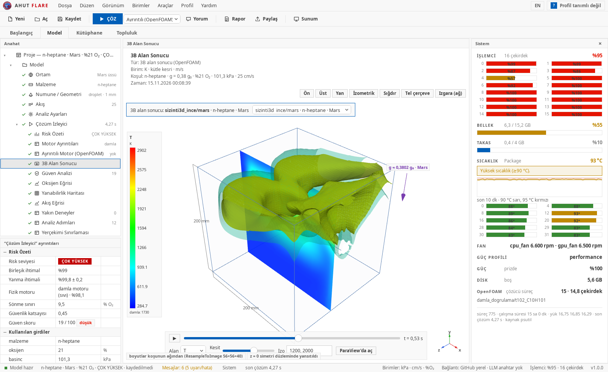
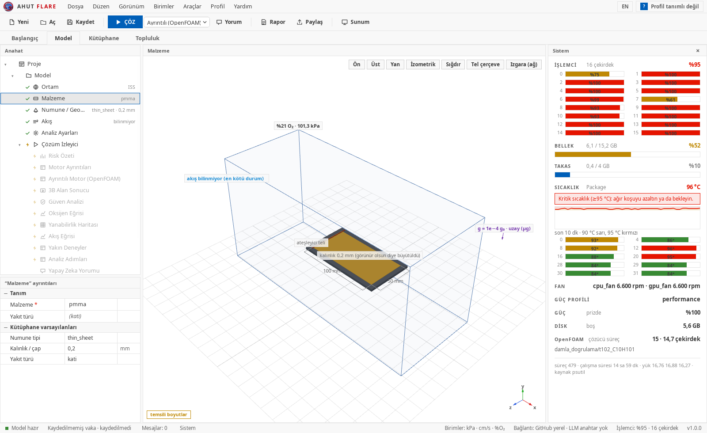
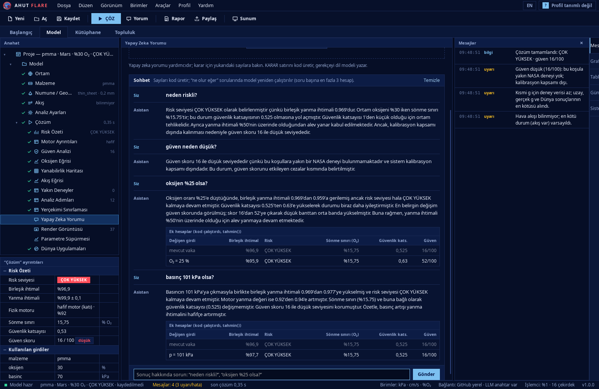
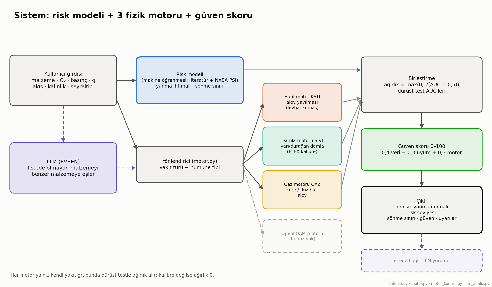
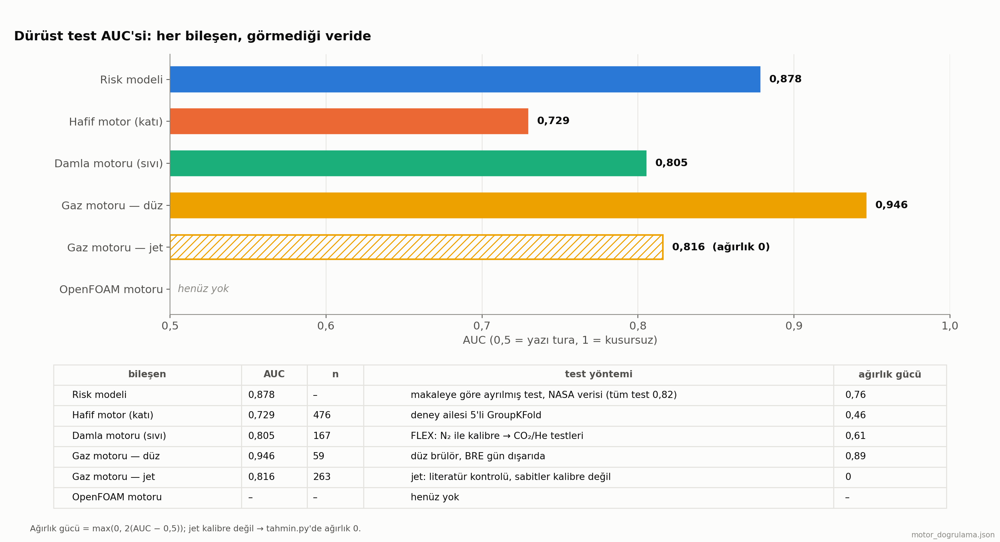

<div align="center">


# AHUT FLARE

**F**ire · **L**earning · **A**nalysis · **R**esearch · **E**ngine

*Uzayda yangın güvenliği için masaüstü analiz ortamı*

**ISS · Ay · Mars** koşullarında bir malzemenin yanıp yanmayacağını tahmin eder ve tahmini<br>
gerçek **NASA mikro yerçekimi yanma deneyleriyle** karşılaştırır.


[Ne yapar](#-ne-yapar) · [Ekranlar](#-ekranlar) · [Nasıl çalışır](#-nasıl-çalışır) · [Doğrulama](#-doğrulama) · [Kurulum](#-kurulum) · [Klasörler](#-klasör-yapısı) · [English](#-in-english)



<sub>Mars yerçekiminde (0,38 g) n-heptan: OpenFOAM alan sonucu uygulamanın içinde, sıcaklık izo yüzeyleri + kesit + zaman kaydırıcısıyla.</sub>

</div>

---

## ✨ Ne yapar

Bir **ortam** (yerçekimi, basınç, oksijen, seyreltici gaz, hava akışı) ve bir **malzeme** verirsiniz; AHUT FLARE şunları döndürür:

| Çıktı | Anlamı |
|---|---|
| 🔥 **Risk seviyesi** | DÜŞÜK · ORTA · YÜKSEK · ÇOK YÜKSEK |
| 📈 **Yanma ihtimali** | 0–1, belirsizlik aralığıyla |
| 🧯 **Sönme sınırı** | Bu oksijen yüzdesinin altında alev söner |
| 🛡️ **Güvenlik katsayısı** | `sönme sınırı / ortam oksijeni`; 1'in altı "yanabilir" demektir |
| ✅ **Güven skoru** | 0–100; sonuca ne kadar güvenilebileceği (veri yakınlığı + model–motor uyumu + motor başarısı) |
| ⚠️ **Uyarılar** | Eksik girdi, model–motor çelişkisi, kalibrasyon dışı bölge |

Yanında:

- **Grafikler:** oksijen eğrisi, yerçekimi × oksijen yanabilirlik haritası, akış eğrisi ve bu koşula **en yakın gerçek NASA deneyleri**.
- **İki çözüm türü:**
  - **Hızlı:** risk modeli + yarı-ampirik motorlar, saniyenin altında.
  - **Ayrıntılı:** OpenFOAM CFD koşusu; uygulamanın içinden kuyruğa eklenir, canlı izlenir.
- **3B görüntüleyici:** girdi düğümlerinde numune geometrisi, kabin, yerçekimi ve akış okları. Sonuç düğümünde OpenFOAM alanları: izo yüzey, kesit, zaman, "ParaView'da aç".
- **Çözüm İzleyici:** canlı günlük, kalıntı grafikleri, işlemci/sıcaklık/disk paneli, koşu kuyruğu.
- **Parametre süpürmesi:** bir girdiyi aralık boyunca değiştirip **güvenlik eşiğini** bulur. Örnek soru: "Bu malzeme için oksijeni en fazla kaça çıkarabilirim?"
- **Yapay zeka yorumu ve sohbet (isteğe bağlı):** sayıları kod üretir; dil modeli yalnız gerekçeyi yazar ve "ya oksijen %25 olsa?" gibi soruları modeli yeniden çalıştırarak yanıtlar.
- **İki dil ve iki tema:** Türkçe / İngilizce, açık / koyu tema.

---

## 🖼️ Ekranlar

<table>
<tr>
<td width="50%"><br><sub><b>Risk özeti</b> — Mars üssünde PMMA</sub></td>
<td width="50%"><br><sub><b>Yanabilirlik haritası</b> — yerçekimi × oksijen</sub></td>
</tr>
<tr>
<td><br><sub><b>3B girdi sahnesi</b> — ISS'te ince PMMA levha, akış kanalı ve ateşleyici</sub></td>
<td><br><sub><b>OpenFOAM vakası</b> — Saffire SIBAL numunesi, gerçek boyutlar ve hücre ağı</sub></td>
</tr>
<tr>
<td><br><sub><b>Ayrıntılı motor</b> — OpenFOAM koşusu ↔ hızlı motor ↔ deney</sub></td>
<td><br><sub><b>Sohbet</b> — "ne olur eğer" soruları modeli yeniden çalıştırır</sub></td>
</tr>
</table>

---

## 🧠 Nasıl çalışır



1. **Risk modeli (makine öğrenmesi)**
   - NASA PSI deney veritabanı ve literatürden derlenmiş etiketli deneylerle eğitildi.
   - Yanma ihtimalini ve sönme sınırını verir (`scripts/risk_model.py`, `models/`).
2. **Yönlendirici** (`scripts/engine.py`) yakıt türüne ve numune tipine göre bir fizik motoru seçer:
   - **Katı:** hafif alev yayılma motoru (`scripts/light_engine.py`)
   - **Sıvı:** yarı-durağan damla motoru, FLEX'e kalibre (`scripts/droplet_engine.py`)
   - **Gaz:** küre / düz / jet alev motoru (`scripts/gas_engine.py`)
3. **Birleştirme**
   - Model ve motor, **dürüst test AUC'lerine** göre ağırlıklandırılır: `ağırlık = max(0, 2·(AUC − 0,5))`.
   - Kalibre olmayan bileşenin ağırlığı 0'dır.
4. **Güven skoru:** `100 × (0,4·veri + 0,3·uyum + 0,3·motor)`.
5. **Ayrıntılı çözüm (OpenFOAM)**
   - Katı numuneler için çok bölgeli (gaz / katı / ateşleyici teli) piroliz ve alev çözücüsü: `openfoam_motor/`.
   - Panelden kütüphane malzemesiyle kurulan vakalar (`dashboard/engine/ofm_case.py`):
     - Katı: SIBAL (doğrulanmış) ve PMMA; parametreler `ofm_material_params.json` (kaynaklı, doğrulanmamış olanlar işaretli).
     - Sıvı (damla): n-heptan, metanol, etanol, n-dekan; 1B küresel, küçülen çap, tek adım yanma (`ofm_droplet_case.py`). Yalnız n-heptan ve metanol FLEX'e kalibre.
     - Gaz: metan, etan, propan, etilen, asetilen; gözenekli küre brülör, 1B küresel, mikroyerçekimi (`ofm_gas_case.py`). Kinetik ve taşınım sabitleri doğrulanmadı, ışınım modeli yok.
   - Diğer damla ve gaz brülörü vakaları: `of_*.py`.
   - Sonuçlar içe aktarılır ve deneyle karşılaştırılır. Koşu ancak koşula yakın ve deneyle doğrulanmışsa birleşik sonuca katılır.
6. **LLM**
   - Listede olmayan bir malzemeyi en yakın bilinen malzemeye eşler.
   - İsteğe bağlı yorum yazar. Karar satırını her zaman kod üretir.

Denklemler ve varsayımlar: [`presentation/equations.md`](presentation/equations.md) · Ayrıntılı teknik belge: [`docs/DASHBOARD.md`](docs/DASHBOARD.md)

---

## 📊 Doğrulama

Her bileşen, **eğitimde görmediği deney aileleri** üzerinde sınandı: aileye göre gruplu çapraz doğrulama.



| Bileşen | Veri | Dürüst test AUC |
|---|---|---|
| Risk modeli | NASA PSI + literatür | **0,878** |
| Hafif motor (katı) | Saffire, BASS ve diğerleri | 0,729 |
| Damla motoru (sıvı) | FLEX / FLEX-2 | 0,805 |
| Gaz motoru — düz alev | BRE | 0,946 |
| Gaz motoru — jet alev | SFLAME | 0,816 *(kalibre değil → ağırlık 0)* |

**OpenFOAM doğrulaması (sürüyor)**

| Deney | Yakıt türü | Durum |
|---|---|---|
| NASA FLEX | n-heptan damla | Tek damla vakaları koşuluyor |
| ISS BRE | etilen brülör | Eksenel simetrik vakalar koşuluyor |
| BASS | SIBAL kumaş | Koşuluyor |

**Bilinen sınırlar** (ayrıntı: `presentation/presentation_summary.md`):

- **Kısmi yerçekimi:** Ay ve Mars için doğrudan deney verisi yok; sonuçlar ISS ve Dünya verisinden ara değerlendirilir.
- **Işınım:** damla CFD vakaları ışınımsız. Bu yüzden büyük damlalarda görülen ışınım kaynaklı sönmeyi yakalamazlar.
- **Gaz ışınımı:** gaz CFD'de gri gaz ışınımı, ölçülen ışınım kesrine göre ölçeklendi.

---

## 🚀 Kurulum

### Windows

`AHUT-FLARE-Setup.exe` → İleri → Kur.

Python, model ve veri programın içinde gelir. Kurulum paketi `dashboard/packaging/` ile üretilir.

### Linux (Ubuntu 24.04, Python 3.12)

```bash
git clone https://github.com/ErdemA33/AHUT-FLARE.git
cd AHUT-FLARE/dashboard

# sistem paketleri (pencere GTK/WebKit ile açılır)
sudo apt install python3-venv python3-gi gir1.2-webkit2-4.1

# Python ortamı
python3 -m venv --system-site-packages .venv
.venv/bin/pip install -r requirements.txt

./run.sh --sinama     # pencere açmadan kendini sınar → "SONUÇ: BAŞARILI"
./run.sh              # uygulamayı açar
```

> **Python 3.12 gerekir.** Model `scikit-learn 1.4.1.post1` ile eğitildi ve aynı sürümle açılmalı.

**İsteğe bağlı:**

| Özellik | Gerekenler |
|---|---|
| Ayrıntılı (OpenFOAM) çözüm | OpenFOAM 14 (`/opt/openfoam14`). Katı vaka paketinin yolu `AHUT_MOTOR_C` ortam değişkeniyle verilir. |
| 3B alan dışa aktarma ve "ParaView'da aç" | ParaView (`pvpython`) |
| Yapay zeka yorumu | EVREN API anahtarı (`evren_anahtar.txt`; örnek: `dashboard/evren_key_EXAMPLE.txt`). Anahtar depoya **konmaz**. |

Komut satırı seçenekleri:

```bash
python ahut_flare.py --mock      # modelsiz arayüz denemesi
python ahut_flare.py --ayikla    # geliştirici araçları açık
python ahut_flare.py vaka.ahut   # kayıtlı bir vakayı açarak başla
```

---

## 🗂️ Klasör yapısı

```
AHUT-FLARE/
├── dashboard/                 Masaüstü uygulaması (pywebview + HTML/JS arayüz)
│   ├── ahut_flare.py            giriş noktası · run.sh / run.bat başlatıcı
│   ├── core/                    Python köprüsü, Çözüm İzleyici, 3B sahne verisi
│   ├── ui/                      arayüz (js/, style/, brand/, fonts/, vendor/three.min.js)
│   ├── engine/                  arka ucun uygulamaya paketlenen kopyası (engine_sync.py)
│   ├── data/                    örnek vakalar (examples/), kullanıcı verisi (cases/, logs/)
│   ├── site/                    GitHub Pages sitesi
│   └── packaging/               Windows kurulum paketi
├── scripts/                   Araştırma betikleri (tek klasör: birbirini içe aktarır)
│   ├── predict.py                Tek giriş: koşul → risk, ihtimal, sönme sınırı, güven
│   ├── risk_model.py             Makine öğrenmesi modeli (+ models/)
│   ├── engine.py                 Yönlendirici ve birleştirme
│   ├── light_engine.py · droplet_engine.py · gas_engine.py    Hızlı fizik motorları
│   ├── ofm_*.py                  OpenFOAM motoru: vaka hazırlama, içe aktarma, analiz, karşılaştırma
│   ├── of_*.py · of_*.sh         OpenFOAM damla / gaz / sızıntı vakaları, kuyruk ve doğrulama
│   └── psi_*.py · data_extract*.py   NASA PSI veri çıkarma ve etiketleme
├── data/ · figures/ · docs/ · logs/   Betiklerin ürettiği CSV/JSON, grafikler, raporlar, günlükler
├── models/                    Eğitilmiş risk modeli
├── openfoam_motor/ · openfoam_motor_v2/ · ofm_test/   Katı yanma çözücüsü (OpenFOAM, C++), kalibrasyon ve test vakası
├── gas_data/ · experiments/ · gas_experiments/   Deney tabloları ve kalibrasyon denemeleri
├── of_visual/                 Görsel/ekran çıktıları
└── presentation/              Sunum grafikleri (TR/EN) ve denklemler
```

**Testler:**

```bash
python scripts/integration_test.py       # uçtan uca arka uç
python scripts/ofm_test.py               # OpenFOAM motoru içe aktarma / analiz / yönlendirici
cd dashboard && ./run.sh --sinama
```

---

## 🛰️ Veri kaynakları

NASA **Physical Sciences Informatics (PSI)** deneyleri:

| Deney | Konu |
|---|---|
| Saffire I–III | Büyük ölçekli katı yangınları |
| BASS / BASS-II | Katılarda alev yayılması ve sönmesi |
| FLEX / FLEX-2 | Damla yanması |
| BRE | Gözenekli brülörde gaz alevleri |
| SFLAME | Duman noktası alevleri |

Bunlara ek olarak açık literatürdeki LOI / MLOC ölçümleri kullanıldı. Her deney satırının kaynağı veri dosyalarında `kaynak` sütununda tutulur.

---

## 👥 Takım

**AHUT** — Ankara Havacılık ve Uzay Teknolojileri Hackathon Takımı · NASA Space Apps Challenge 2026

Katı yanma OpenFOAM çözücüsü (`openfoam_motor/`) ve Saffire kalibrasyonu: **OpenFOAM motoru**.

## 📄 Lisans

[MIT](LICENSE) © 2026 AHUT

---

## 🌍 In English

**AHUT FLARE** is a desktop analysis environment for fire safety in space.

- **What it predicts:** given an environment (gravity, pressure, oxygen, diluent, airflow) and a material, it predicts the risk level, ignition probability, extinction limit, safety factor and a 0–100 confidence score.
- **How:**
  - a machine-learning risk model trained on NASA PSI microgravity combustion data;
  - semi-empirical solid / droplet / gas physics engines;
  - optional OpenFOAM CFD runs that are queued, monitored and visualised in 3D inside the app.
- **Honest validation:** every component is weighted by its out-of-family test AUC (risk model 0.878; solid 0.729; droplet 0.805; gas flat flame 0.946), and every result is compared against the nearest real NASA experiments (Saffire, BASS, FLEX, BRE, SFLAME).
- **Run it:** see [Kurulum](#-kurulum). Linux: `cd dashboard && ./run.sh`; Windows: installer.

The UI is bilingual (Turkish / English). Built for the NASA Space Apps Challenge 2026.
